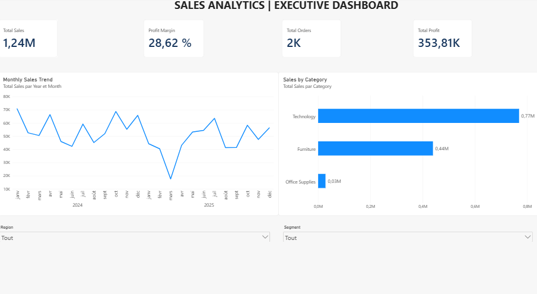
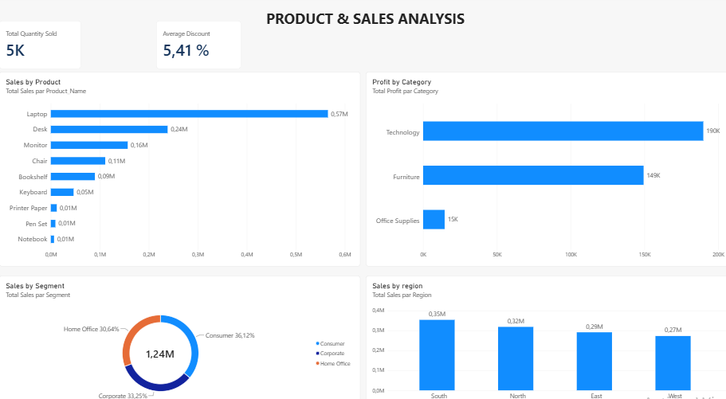
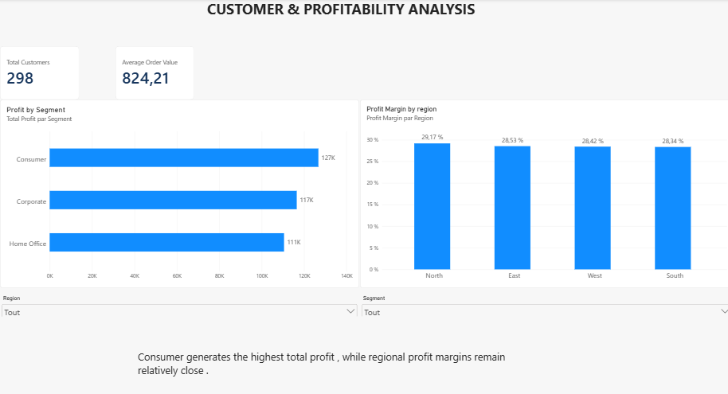
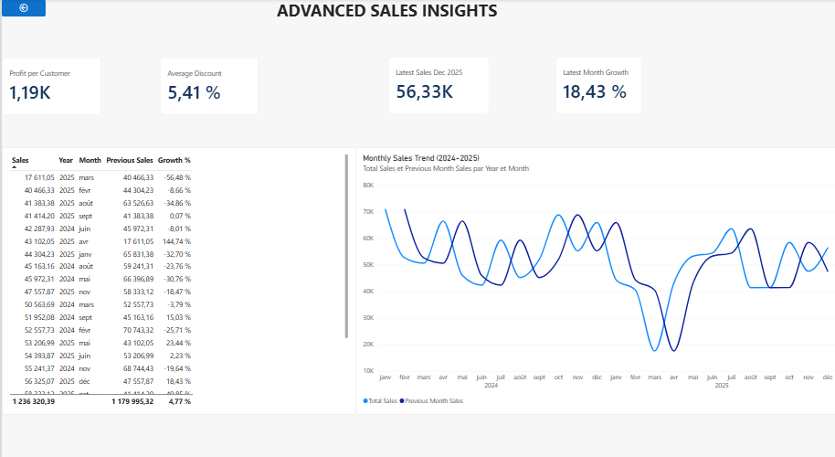

#  Sales Analytics Dashboard | Power BI

### Business Intelligence & Sales Performance Analysis

An interactive **Power BI dashboard** designed to analyze sales performance, product trends, customer segments, regional profitability, and monthly revenue growth.

This portfolio project demonstrates an end-to-end Business Intelligence workflow, from data preparation and modeling to interactive reporting and business insights.

##  Project Objectives

- Monitor sales and profitability KPIs.
- Identify top-performing products and categories.
- Analyze customer segments and regional performance.
- Track monthly sales trends and growth.
- Transform analytical findings into actionable business recommendations.

##  Technologies & Skills

- **Power BI Desktop** — Interactive dashboards and data visualization
- **Power Query** — Data cleaning and transformation
- **DAX** — KPI calculations and time intelligence
- **Data Modeling** — Relationships between Sales and Calendar tables
- **Business Intelligence** — Performance monitoring and reporting
- **Data Analysis** — Trend analysis and business insights

##  Dashboard Overview

The dashboard contains four analytical pages.

### 1. Executive Overview

Provides an overview of revenue, profit, profit margin, order volume, monthly sales trends, and category performance.

### 2. Product & Sales Analysis

Explores sales by product, profit by category, customer segment contributions, and regional sales distribution.

### 3. Customer & Profitability Analysis

Analyzes customer counts, average order value, segment profitability, and regional profit margins.

### 4. Advanced Sales Insights

Uses DAX time-intelligence measures to compare current and previous monthly sales and calculate month-over-month growth.

##  Key Performance Indicators

| KPI | Value |
|---|---|
| Total Sales | 1.24M |
| Total Profit | 353.81K |
| Profit Margin | 28.62% |
| Total Customers | 298 |
| Average Order Value | 824.21 |
| Average Discount | 5.41% |
| Latest Month Sales (Dec 2025) | 56.33K |
| Latest Month Growth | +18.43% |

**Data coverage:** January 2024 – December 2025.

*Monetary values are displayed without a currency symbol because the source currency has not been confirmed.*

##  Key Business Insights

- Technology generates the highest category revenue.
- Laptop is the leading product by sales.
- Consumer contributes the highest absolute profit among customer segments.
- Regional profit margins remain relatively close.
- Sales increased by **18.43% in December 2025** compared with November 2025.
- The significant sales decline in March 2025 deserves further investigation.

## Business Recommendations

1. Investigate the March 2025 sales decline by product, region, and customer segment.
2. Monitor revenue concentration in Technology and Laptop products.
3. Evaluate lower-performing products using sales, profit, and discount indicators.
4. Compare regional revenue with profitability.
5. Conduct regular monthly performance reviews using DAX-based growth indicators.

##  Project Files

- **Power BI dashboard:** `Sales_Analytics_Dashboard.pbix`
- **Dashboard screenshots:** `screenshots/`
- **Business analysis report:** `reports/`

The professional PDF report includes the methodology, KPI definitions, business findings, recommendations, and limitations.

##  Project Outcome

This project strengthened practical skills in Power BI, Power Query, DAX, data modeling, KPI development, and business reporting.

It demonstrates the ability to transform sales data into meaningful visualizations and decision-oriented business insights.
